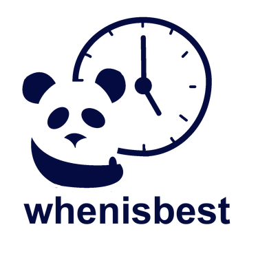

## Purpose

This project focuses on developing a “Group Calendar” for people. It will involve automated scheduling to determine a timeslot when most, if not all, of your friends and family will be available. Determination of the “best” time will rely on a ranking feature that prioritizes multiple factors such as group availability and event importance. Users input their schedules (not visible to other users) into the application, and event suggestions are presented to them accordingly, based on what they sign up for. WhenIsBest also introduces a “group” feature. A user can be a member of multiple groups and use the same schedule for all of them. 

### Proposed functionality:

- Importing calendars for a group of users that will auto-generate the best times for a group of users to meet.
- Allow users to set priorities of their current obligations (strict, flexible).
- Permits privacy (so nobody else will know exactly what you're up to)

## Audience
Anyone with a busy schedule (e.g., organizations, group project members, friend groups, etc.) 

## Languages
HTML, CSS (SASS), JavaScript (CoffeeScript), Ruby on Rails 

## Goals (Fall 2017 Project)
- Guest feature (11/10)
    - Not requiring login, but still be able to use (limited) functionality
    - Create a group code for each group member?
- Adding Priority Events (11/10)
    - The ability for newly created events to overtake events that are already on a user’s calendar
- More user-friendly interface (12/13)  
    - Stylize HTML/CSS for “Manage Groups” page
    - Stylize HTML/CSS for “Suggest group event” page
    - Enhance calendar (use different colors for different events, organize view of overlapping events, etc.)
- Extensive Documentation (12/13)
    - Write back-end documentation
    - Finish front-end documentation
    - Update README
- Notifications (12/13) 
    - Alerting users when: A new event is created in the group, something changed in the group, reminders of important events (using priority), use emails, pop-ups, etc. 
- Extension of algorithm (11/10)
    -If no time slot is available for a group, the algorithm will factor in how many users are available

## Current Bugs
- Inability to sync the project with Google Calendar because of an unresolved error

## Features Wanted in the Future
- A domain name
- Sync with Facebook events if possible? Or automatically pull in events from the area
- ChatBox to be able to discuss
- Events: Event planner with optimal times to host event, Events sorted by certain factors (e.g., number of users available, etc.)

## Other repositories:

https://github.com/WhenIsBest/simple_calendar

To receive the most recent updates to the simple_calendar code, one should copy and paste the code from the files in the simple_calendar repo (look at the most recent commits) into their own files. If you can find a way to pull from the repo instead, please let us know.

This repository was forked from an open-source Ruby gem named "simple_calendar" on GitHub that provided us with our calendar functionality. Modifications were made to the gem to best align with WhenIsBest.

## How to run whenisbest in your local server
Complete installation and contribution guidelines can be found in our [Wiki](https://github.com/WhenIsBest/whenisbest/wiki) page!

WhenIsBest is a project within RCOS (Rensselaer Center for Open Source) at Rensselaer Polytechnic Institute.
